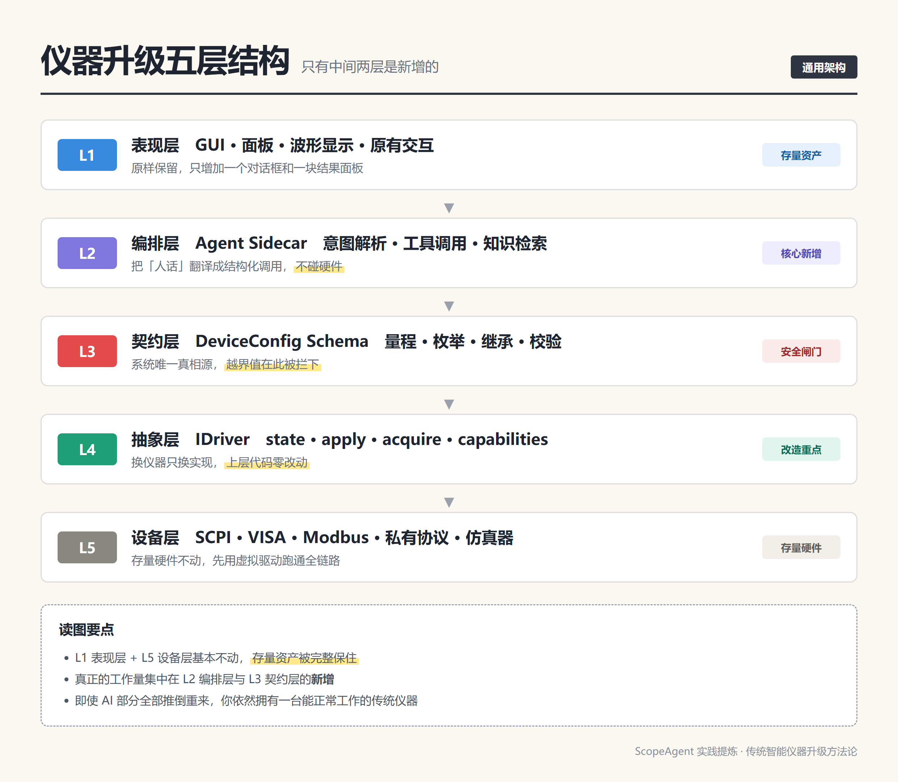
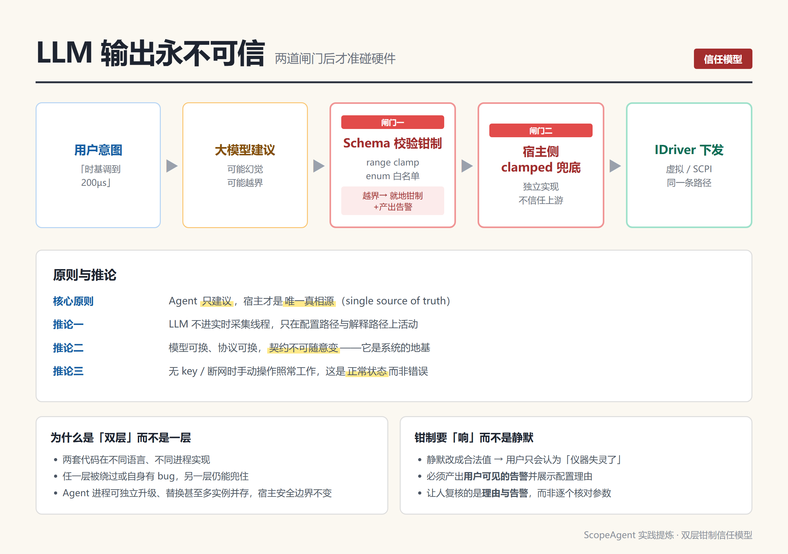
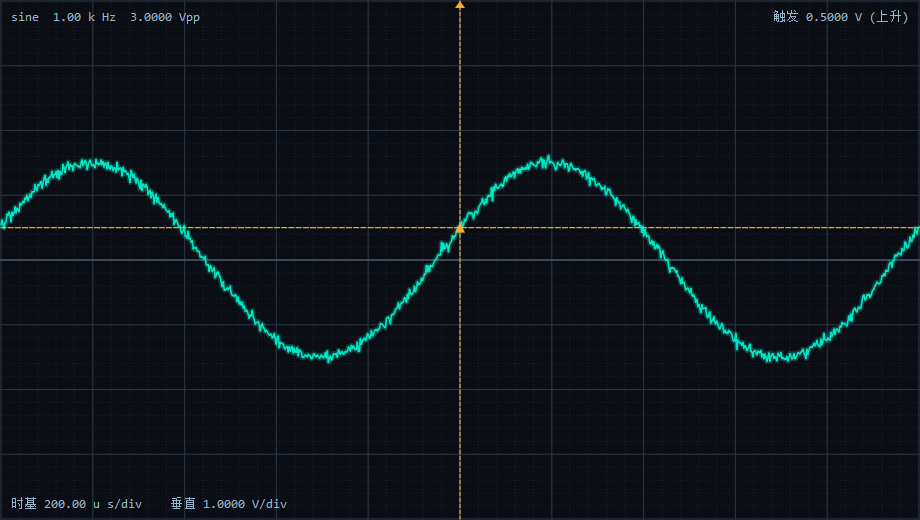

# 给传统仪器装上「大模型」：一套可落地的通用升级架构

> 副标题：从ScopeAgent 项目实践中提炼的五层解耦方法论

---

## 引子：为什么多数「AI 仪器」项目会失败

打开一台十年前设计的频谱仪或示波器，你会看到这样一幕：面板上几十个旋钮和按键，屏幕上一层层菜单，操作手册800 页。用户想看一个 3Vpp、1kHz 的信号波形，得先理解时基、垂直档位、触发耦合、采样率这四个概念，还要理解它们之间的联动约束。

这不是设计缺陷，是**交互成本的必然代价**——在 GUI 图形界面成熟之前，操作复杂度是不得不付的税。

大模型带来了一个重新定价的机会：**让用户用自然语言表达意图，由系统自动完成参数推理**。但很多团队一上手就把大模型接进了驱动层，效果立竿见崖地差：

| 常见做法 | 后果 |
|---|---|
| LLM 输出直接调`driver->apply()` | 一次幻觉就能损坏被测对象或仪器 |
| 在原有 C++ 主进程里直接嵌入 Python/LLM 运行时 | 采集时序被污染，实时性彻底失守 |
| 每一类仪器重新设计一套 Prompt 与字段 | 无法规模化，模型一换全线重做 |
| 把 Agent 当成「自动执行的脚本」 | 出错时用户不知道发生了什么，也无法人工接管 |
| 依赖外网API 与云端密钥 | 内网、涉密、现场环境直接不可用 |

问题不在模型能力，而在**架构位置**：模型被放在了离硬件太近的地方。

我们在一个真实的 Qt + C++ 示波器项目（ScopeAgent）里验证了一套解法。这套方法论不限于示波器，对频谱仪、矢量网络分析仪、源表、功率计、任意信号发生器乃至工业测试台架都成立。

---

## 一、核心结论先给

**把大模型放在「建议层」，把下发权留在「设备抽象层」，中间用一份显式的契约隔开。**

具体到结构，就是五层：

```
L1 表现层    GUI / 面板 / 原有交互          —— 存量保留，局部增补
L2 编排层    Agent Sidecar（意图/工具/知识） —— 全新增
L3 契约层    Schema（量程/枚举/继承/校验）   —— 全新增
L4 抽象层    IDriver 驱动接口                —— 重点改造
L5 设备层    SCPI/VISA/Modbus/私有协议       —— 存量不动
```

其中最关键的判断是：**L1 和 L5 基本不动，L4 小改，工作量的绝大部分集中在 L2 与 L3 的新增**。这意味着「AI 化」的工程风险是可控的——即使 AI 部分全部推倒重来，你依然拥有一台能正常工作的传统仪器。



---

## 二、架构选型：为什么是「双进程 Sidecar」

### 1.1 三种集成方案的取舍

把 Agent 能力引入 C++ 宿主，业界常见三种做法：

| 方案 | 做法 | 优点 | 致命问题 |
|---|---|---|---|
| **进程内嵌** | 主程序链接 Python/LLM 运行时，直接调函数 | 延迟最低、无 IPC | 崩溃传染、依赖污染、实时线程被GC/推理抖动影响，Qt 与 Python 生命周期难协同 |
| **DLL/so 动态库** | C++ 写推理逻辑，模型侧只提供推理库 | 性能好、部署一体 | 绑定模型运行时，升级模型就要重编主程序；ABI 脆弱；仍无法隔离崩溃 |
| **独立进程 Sidecar（推荐）** | Agent 跑在独立进程，通过本地 HTTP/JSON 通信 | 崩溃隔离、语言自由、可独立升级、可打包 | 多一次 IPC（本地环回，毫秒级，可接受） |

我们选了第三种。ScopeAgent 的做法是：C++ 侧用 `QProcess` 拉起 Python sidecar，轮询 `/health` 直到就绪，再 POST `/v1/configure`。

关键细节值得单独强调：

```cpp
// app/src/agentclient.cpp
// 优先使用打包好的独立 exe（无需 Python），否则回退 python server.py
QString sidecarExe = agentDir + "/scopeagent-sidecar.exe";
if (QFileInfo::exists(sidecarExe)) {
    program = sidecarExe;
    args << "--port" << QString::number(m_port);
} else {
    program = findPython();          // 找不到则明确降级
    if (program.isEmpty()) {
        emit statusChanged("未找到 Python（且无 sidecar 可执行文件）", false);
        return;
    }
    args << "-u" << "server.py" << "--port" << QString::number(m_port);
}
```

三个设计决策值得复用：

- **进程生命周期由宿主管理**：`QProcess` 启动、退出即信号通知、析构时kill 并等待，避免僵尸进程。
- **就绪探测用轮询而非假设**：sidecar 启动有 Python 解释器/PyInstaller 解包的耗时，固定 sleep 是脆弱的。
- **打包形态可切换**：开发期用脚本、发布期用单文件 exe，同一套代码两种运行形态。这让「目标机不装 Python」成为可能。

另外一个小而重要的细节：Windows 下隐藏子进程控制台窗口。

```cpp
m_process->setCreateProcessArgumentsModifier([](QProcess::CreateProcessArguments* a) {
    a->flags |= CREATE_NO_WINDOW;   // 对 python 与打包 exe 均生效
});
```

### 1.2通信层：为什么是本地 HTTP/JSON

Sidecar 与宿主之间，我们选了`127.0.0.1:8765` 上的 HTTP/JSON，而不是 gRPC、WebSocket 或命名管道。

理由很务实：

- **可观测**：任何 HTTP 客户端、浏览器、甚至 `curl` 都能复现问题，降低调试成本。
- **跨语言零成本**：Python 标准库 `http.server` 即可实现，无需 protobuf 代码生成与版本对齐。
- **天然异步**：`QNetworkAccessManager` 天然支持，UI 永不阻塞。
- **可平滑升级**：接口形状与 MCP 高度重合，后续换成 MCP 端点不需要重构宿主。

唯一需要注意的兼容性坑：Qt 5.12 没有 `QNetworkReply::setTransferTimeout`，健康检查必须自己加单次定时器中止：

```cpp
// Qt 5.12 无 setTransferTimeout，用单次定时器兜底中止
QTimer* abortTimer = new QTimer(reply);
abortTimer->setSingleShot(true);
connect(abortTimer, &QTimer::timeout, reply, &QNetworkReply::abort);
abortTimer->start(1000);
```

---

## 三、契约层：整个体系的定海神针

这是整套架构里**最重要、也最容易被低估**的一层。

### 3.1 Schema 是唯一真相源

我们定义了一份 `DeviceConfig` 契约，它同时定义了：字段名、类型、量程、枚举白名单、默认值。

```python
# agent/schema.py
CONFIG_FIELDS = {
    "waveform":        {"type": "enum",   "values": ["sine","square","triangle","sawtooth","noise"], "default": "sine"},
    "frequency_hz":    {"type": "number", "min": 1.0, "max": 10_000_000.0, "default": 1000.0},
    "amplitude_vpp":   {"type": "number", "min": 0.01, "max": 100.0, "default": 3.0},
    "dc_offset_v":     {"type": "number", "min": -100.0, "max": 100.0, "default": 0.0},
    "sec_per_div":     {"type": "number", "min": 0.000_000_5, "max": 1.0, "default": 0.0005},
    "volts_per_div":   {"type": "number", "min": 0.005, "max": 20.0, "default": 1.0},
    "trigger_level_v": {"type": "number", "min": -100.0, "max": 100.0, "default": 0.0},
    "trigger_slope":   {"type": "enum",   "values": ["rising","falling"], "default": "rising"},
    "noise_level":     {"type": "number", "min": 0.0, "max": 1.0, "default": 0.02},
}
```

这份定义在 C++ 侧有对应镜像：

```cpp
// app/src/deviceconfig.h
struct DeviceConfig {
    QString waveform = "sine";
    double frequencyHz = 1000.0;double amplitudeVpp = 3.0;
    double secPerDiv = 0.0005;        double voltsPerDiv = 1.0;
    double triggerLevelV = 0.0;       QString triggerSlope = "rising";
    double noiseLevel = 0.02;
    static DeviceConfig fromJson(const QJsonObject& o, const DeviceConfig& base);
    static DeviceConfig clamped(const DeviceConfig& c);   // 兜底钳制
};
```

**必须提醒的一个坑**：这份契约在两个地方各有一份实现（Python 侧 + C++ 侧），增删改字段时必须同步改两处，且注意线格式用 `snake_case`（`frequency_hz`）而 C++ 成员是 `camelCase`（`frequencyHz`）。这是双语言架构的固有代价——要么加契约生成脚本，要么在 CI 里加一致性校验。

### 3.2 工具 Schema 从契约自动派生

这里有个很划算的设计：**LLM 看到的工具参数定义，直接从 `CONFIG_FIELDS` 生成，而不是手写**。

```python
# agent/tools.py
def build_tools():
    props = {}
    for name, spec in CONFIG_FIELDS.items():
        if spec["type"] == "enum":
            props[name] = {"type": "string", "enum": spec["values"]}
        else:
            props[name] = {"type": "number", "minimum": spec["min"], "maximum": spec["max"]}
    ...
```

好处有三：

1. **消除漂移**：契约改了，工具定义自动跟着变，不会出现「Prompt 说能设 200V、Schema 却只允许 100V」的错位。
2. **约束前置到解码层**：把 `minimum`/`maximum`/`enum` 直接写进 function calling 的 JSON Schema，模型在生成阶段就被引导向合法值——**这比事后校验便宜得多**。
3. **新增仪器类型只需换一份 Schema**：契约即文档，即模型的知识边界。

### 3.3 缺省继承：让 Agent 只说变化量

用户很少一次性说清全部参数。`validate_config(cfg, base)` 的设计是：未提及的字段从当前状态继承，而非重置为默认值。

```python
def validate_config(cfg, base=None):
    for name in FIELD_ORDER:
        spec = CONFIG_FIELDS[name]
        if name in cfg and cfg[name] is not None:
            ...          # 校验并钳制
        else:
            out[name] = base.get(name, spec["default"])   # 继承当前值
```

这一点直接决定体验好坏。「时基调到 200µs」不应该把用户之前设好的垂直档位、触发电平全部抹掉重置。

---

## 四、信任模型：双层钳制（本方案的核心）

### 4.1 不可信输出的处理

大模型的输出**必须**假设为不可信输入。理由不新鲜：幻觉、越界、格式错误、单位混淆、枚举幻觉。我们把防护做成两道独立的闸门。



**闸门一：Python 侧 schema 校验**（在 Agent 进程内）

```python
def _clamp_number(value, lo, hi, default):
    try:
        v = float(value)
    except (TypeError, ValueError):
        return default            # 解析失败 → 回退，绝不把异常抛给硬件路径
    if v < lo: return lo
    if v > hi: return hi
    return v
```

同时做**软约束一致性检查**——这类检查不改参数，只产生告警：

```python
# 一致性规则：时基应能展示至少 1~2 个周期（软约束，仅告警）
period = 1.0 / out["frequency_hz"]
if out["sec_per_div"] > period * 10:
    warnings.append("时基 %ss/div 相对频率 %sHz 偏慢，可能看不到完整周期，建议减小")
```

**闸门二：Qt 侧 `clamped()` 兜底**（在宿主进程内，独立实现）

这是**纵深防御**，不是冗余重复：

- 两套代码在不同语言、不同进程，任一层被绕过或自身有 bug，另一层仍能拦住。
- Agent 进程可被整体替换、升级、甚至多Agent 并存，宿主的安全边界不变。
- 宿主是唯一真相源，最终合法性由宿主判定。

### 4.2 钳制要「响」而不是静默

一个容易被忽视的设计细节：钳制必须产出**用户可见的 warnings**，并把配置理由（rationale）一起展示。

```python
warnings.append("%s=%s 超出范围 [%s,%s]，已钳制为 %s" %
                (name, before, spec["min"], spec["max"], out[name]))
```

如果静默地把超范围值改成合法值，用户会认为「仪器失灵了」。让人复核的是**理由与告警**，而不是逐个核对参数——这是把智能引入专业仪器的正确姿态。

### 4.3 离线是正常状态，不是错误

```python
if not SETTINGS.get("api_key"):
    self._send_json(503, {"ok": False, "error": "未配置 API KEY，..."})
    return
```

缺 key / 断网时返回 503，宿主 UI 降级为纯手动操作。**这不是降级容错，这是产品定义的一部分**——工业现场、内网环境、涉密项目里，AI 功能本就不该是唯一入口。

---

## 五、驱动抽象：让「换仪器」变成零成本

```cpp
// app/src/deviceconfig.h
class IDriver {
public:
    virtual ~IDriver() = default;
    virtual QString id() const = 0;virtual QString name() const = 0;
    virtual DeviceConfig state() const = 0;              // 读当前配置
    virtual bool apply(const DeviceConfig& c) = 0;       // 下发配置（含钳制）
    virtual QVector<double> acquire(int points, double triggerPos = 0.0) const = 0;
    virtual QStringList capabilities() const = 0;       // 能力描述（供 Agent 查询）
    virtual bool connected() const = 0;
};
```

这个接口的六个方法是有意为之的精简：

- `state()` / `apply()` 构成配置闭环；
- `acquire()` 把数据获取抽象出来，Agent 不需要知道波形怎么来；
- `capabilities()` 把**能力描述**暴露给 Agent，让它能先「预研」再动手；
- `connected()` 让宿主能明确显示在线状态。

我们实现了两个驱动：

| 驱动 | 作用 | 关键实现 |
|---|---|---|
| `VirtualScopeDriver` | 软件合成波形，**先跑通全链路** | 正弦/方波/三角/锯齿/噪声 + 触发相位对齐 |
| `ScpiDriver` | 真实仪器接入骨架 | 运行时动态加载 `visa64.dll`，无链接期依赖 |

`ScpiDriver` 有个值得抄的细节：**运行时动态加载 VISA 库**，而不是链接期引入。

```cpp
// 动态加载 visa64.dll / visa32.dll，程序不带链接期 VISA 依赖
// 好处：没有 VISA 环境的机器也能启动，只是连不上仪器
```

这让同一套二进制能在「研发机（有 VISA）」和「现场机（无 VISA）」上都能运行。

而**Agent 侧对这一切完全无感知**——它只与 `DeviceConfig` 契约交互。这是分层的红利。

### 5.1 先跑通虚拟驱动，别一开始就碰硬件

这是实施顺序上的强建议：

```
S1 虚拟驱动 + Schema 契约        → 零硬件风险，逻辑错误快速暴露
S2 接入 LLM，跑通意图→配置       → 体验可演示
S3 补全 SCPI 驱动的收发           → 才第一次面对真实设备
```

虚拟驱动能在无硬件、无实验室环境的条件下，把 AI 编排、契约校验、UI 交互全部验证完。S3 只需把 `acquire()` 里的 `:WAVeform:DATA?` 补上。

**顺带一个必须警惕的坑**：虚拟驱动和 MCP 端如果各写了一份波形合成逻辑，就会出现 GUI 显示与 MCP 返回不一致的双份真相。项目里就出现过——`VirtualScopeDriver::acquire()`（C++）和 `mcp_server.py::synth_samples()`（Python）各实现了同一套波形与触发相位对齐。**改一处必须改另一处**。虚拟驱动要么只有一份实现，要么用一致性测试锁死两者输出。

---

## 六、Agent 编排层：工具化而非prompt 化

### 6.1 用 function calling，不写长 Prompt

工具集设计（`agent/tools.py`）：

| 工具 | 作用 | 模型调用它的时机 |
|---|---|---|
| `get_spec` | 查询能力规格 | **给出建议前应先调用**，做预研 |
| `get_state` | 读取当前配置 | 需要基于现状推理时 |
| `configure_scope` | 生成/下发最终配置 + rationale | 参数推理完成时 |
| `search_knowledge` | 检索本地知识库 | 问题涉及手册/应用笔记时 |

工具描述里写明调用时机，比在系统提示词里写一大段流程规则有效得多：

```python
"description": "查询示波器能力规格（带宽、采样率、可选波形、各档位范围等）。"
               "在给出配置建议前应先调用本工具了解设备能力。"
```

`configure_scope` 强制要求 `rationale`：

```python
"rationale": {
    "type": "string",
    "description": "配置理由，用简洁中文说明为什么这样设置"
                   "（例如根据信号频率计算时基使屏幕显示1~2个周期）",
},
"required": ["rationale"],
```

**这是提升信任的关键设计**：让模型输出「理由」而不只是「结果」。人看到「1kHz 周期 1ms，设200µs/div 可显示约 2 个周期」就理解了自动化决策；只看到一个数字则无从判断。

### 6.2 RAG 补上「仪器不会说」的部分

参数推理是模型的能力，但有两类知识模型天生不知道：**仪器手册细节**和**现场经验**。所以我们加了本地 RAG：

```
导入 .md / .pdf → 切块(size=500, overlap=50) → 向量化 → 余弦检索
```

嵌入后端做了渐进降级：

```python
# agent/embedder.py —— 按可用性自动选择后端
get_embedder()  # 优先 OnnxEmbedder（本地 ONNX，如 bge-small，512维）
                 # 缺 onnxruntime/tokenizers 或模型文件时，回退纯标准库 HashEmbedder
```

值得强调的是：**即使没有 ONNX 模型、没有onnxruntime，RAG 依然可用**，只是退化为字符二元组哈希的词法近似检索。现场环境里「完整可运行」比「效果最优」更重要。

同时注意：RAG 只是补充上下文，`search_knowledge` 返回的文本不参与配置下发，**双层钳制信任模型完全不变**。

---

## 七、MCP 标准化：让仪器能力变成公共设施

架构上还做了一件事：把 sidecar 同时做成一个 MCP（Model Context Protocol）server。

```
stdio:  python agent\mcp_server.py  或  scopeagent-sidecar.exe --mcp
HTTP:   POST http://127.0.0.1:8765/mcp
```

暴露的工具：

| MCP 工具 | 说明 |
|---|---|
| `get_spec` | 查询仪器能力规格 |
| `get_state` | 读取当前配置 |
| `configure_scope` | 生成/下发配置（双层钳制） |
| `acquire` | 采集波形样本 |

客户端接入只需一个配置文件：

```json
{
  "mcpServers": {
    "scopeagent": {
      "command": "C:\\path\\to\\scopeagent-sidecar.exe",
      "args": ["--mcp"]
    }
  }
}
```

这一步的意义超出了技术本身：**同一套工具描述，既能服务内置对话框，也能接入任意 MCP 客户端**（Claude Desktop、Cursor、其他 Agent 框架）。仪器的智能能力从「一个产品的功能」变成「可被任意编排的能力」，这对做仪器平台的公司是重要的架构决策。

---

## 八、界面设计：让人看见推理

AI 仪器的界面不该是「一个输入框 + 一个结果」。ScopeAgent 的布局把三件事分开：

```
┌────────────────────────────────────────────────┐
│  顶栏：状态 / 模型 / 驱动切换                     │
├──────────────────────────┬─────────────────────┤
│WaveformWidget│ 控制面板（读数/手动/知识库）│
│    波形显示              │                     │
├──────────────────────────┴─────────────────────┤
│  对话窗口（自然语言 + 历史） │ 输出结果（配置表 + │
│                              │  理由 + 工具调用） │
└────────────────────────────────────────────────┘
```

三个要点：

1. **原有手动控件全部保留**，AI 是并列的第二入口，不是替代。
2. **推理过程可见**：工具调用序列、配置理由、钳制告警都渲染成格式化块。用户能学、能纠、能信任。
3. **异步不卡 UI**：LLM 调用可能耗时5~30 秒，全程走 `QNetworkAccessManager` 异步，UI 显示「推理中」状态。

波形绘制用 `QPainter` 自绘（网格 / 辉光轨迹 / 触发线 / 刻度），不引入第三方 UI 依赖：



---

## 九、落地清单

如果要动手，按这个顺序：

| 阶段 | 任务 | 验收标准 |
|---|---|---|
| S0 | 定Schema 契约 | 字段表含类型/量程/枚举/默认值，两侧镜像就位 |
| S1 | 虚拟驱动 + Schema 校验 | 单测覆盖 clamp/继承/枚举白名单，全绿 |
| S2 | Sidecar + 工具化 | `curl /health`、`/v1/configure` 返回合法 JSON，越界被钳 |
| S3 | 宿主接入 | 对话框输入 → 配置变更 → 波形变化，UI 不卡 |
| S4 | 双层钳制 | 构造越界/畸形/枚举幻觉输入，两层均能拦住并产出告警 |
| S5 | 真实驱动 | 补全 `acquire()`，真机收发对齐 |
| S6 | RAG + MCP | 导入手册后可检索；MCP 客户端可驱动 |
| S7 | 打包与灰度 | 目标机免 Python 启动；无key 时降级为手动模式 |

**几个必须提前定好的规则**（都是踩出来的）：

- 契约字段增删改必须两侧同步，最好加CI 校验。
- 配置优先级明确：环境变量 > 配置文件；不要把真实密钥提交进仓库。
- 文本文件编码统一 UTF-8；Windows 批处理脚本必须 CRLF，否则 cmd 解析出乱码错误。
- 日志与告警要能追溯到「哪一次调用、哪个字段、被谁钳制」。

---

## 十、这套架构的适用边界

它不是万能的。明确不该用/需要额外设计的地方：

- **实时信号链不要接 AI**：采集、FFT、触发这类实时路径保持纯 C++/DSP。LLM 只出现在配置路径和解释路径。
- **安全相关动作不要交给模型**：过压保护、限流、安全联锁必须由硬件或固件把关，AI 只能建议。
- **强实时/硬实时的场景**：Sidecar 引入 IPC 延迟，若你的场景亚毫秒级响应，需评估是否只在非实时路径使用。
- **LLM 不可用于替代校准**：校准溯源、数值精度、可追溯性要求高的流程，仍走传统计量路径。

---

## 结语：架构决定AI 的天花板

回头看，ScopeAgent 里最有价值的不是「用大模型控制示波器」这件事本身，而是三个可以搬到任何存量仪器上的设计决策：

1. **双进程 Sidecar** —— 把不确定的、慢的、会崩的部分隔离出去，不让它碰到实时与硬件。
2. **显式契约+ 双层钳制** —— 让「AI 只建议、系统做决策」从口号变成可验证的代码路径。
3. **驱动抽象 + 能力暴露** —— 让「换仪器」「换模型」「接生态」都变成配置工作而非重构工作。

传统仪器升级成智能仪器，本质不是加一个模型，而是**在既有软件里插入一层可验证的契约与编排**。做对了，AI 是加速器；做错了，它就是一台昂贵的随机数发生器。

---

*本文架构与代码均来自 ScopeAgent 实践（Qt 5.12 + C++ 宿主 / Python Sidecar / DeepSeek function calling / SCPI-VISA 驱动）。*